<!-- ╔═══════════════════════════════════════════════════════════════════╗ -->
<!-- ║              PHILLIPE BARROS — GITHUB PROFILE                    ║ -->
<!-- ║   Matrix × Cyberpunk × Hacker × Blade Runner × Asimov × Alien   ║ -->
<!-- ╚═══════════════════════════════════════════════════════════════════╝ -->

<!-- ▓▓▓ HEADER — Matrix code rain + Edgerunners glitch ▓▓▓ -->
<p align="center">
  
</p>

<!-- ━━━ DIVIDER ━━━ -->


<!-- ▓▓▓ TYPING SVG — Terminal hacker ▓▓▓ -->
<p align="center">
  
</p>

<!-- ━━━ DIVIDER ━━━ -->


<!-- ▓▓▓ NEOFETCH — Terminal identity block ▓▓▓ -->

```
╔══════════════════════════════════════════════════════════════════╗
║  root@construct:~# neofetch                                     ║
║                                                                  ║
║       ▄▄▄▄▄ ▄  ▄ ▄▄▄▄▄    ▄▄▄  ▄   ▄ ▄▄▄▄▄                    ║
║         █   █▄▄█ █       █   █ ██  █ █                          ║
║         █   █  █ █████   █   █ █ █ █ █████                      ║
║         █   █  █ █       █   █ █  ██ █                          ║
║         █   █  █ █████    ███  █   █ █████                      ║
║                                                                  ║
║   user     : phillipe barros                                     ║
║   class    : full-stack engineer / ai agent architect            ║
║   base     : são paulo :: earth                                  ║
║   shell    : zsh 5.9 + tmux                                     ║
║   editor   : neovim + vscode                                    ║
║   uptime   : 404 days (and counting)                            ║
║   status   : jacked in                                          ║
║   bio      : "devils never cry."                                ║
║                                                                  ║
╚══════════════════════════════════════════════════════════════════╝
```

<!-- ━━━ DIVIDER ━━━ -->


<!-- ▓▓▓ TECH STACK — Pixel art + Neon badges ▓▓▓ -->

<table>
<tr>
<td width="320" align="center">


</td>
<td>

<!-- AI / Agents -->


<br/>
<!-- Frontend -->


<br/>
<!-- Backend -->


<br/>
<!-- Data / Cloud -->


<br/>
<!-- DevOps / Security -->


</td>
</tr>
</table>

<!-- ━━━ DIVIDER ━━━ -->


<!-- ▓▓▓ ASIMOV — As Leis da Robótica ▓▓▓ -->
<p align="center">
  
</p>

<!-- ━━━ DIVIDER ━━━ -->


<!-- ▓▓▓ ALIEN — MU/TH/UR 6000 ▓▓▓ -->
<p align="center">
  
</p>

<!-- ━━━ DIVIDER ━━━ -->


<!-- ▓▓▓ MATRIX — Choose your pill ▓▓▓ -->

<h3 align="center">
  
</h3>

<details>
<summary>🔴 &nbsp; <b>Pílula Vermelha</b> — Veja o quão fundo vai a toca do coelho</summary>

<br/>

```yaml
# ═══ O QUE EU CONSTRUO ═══

ai_agents:
  arquitetura: "LangGraph multi-agent com memória persistente"
  orquestração: "Claude MCP + Gemini 2.5 Pro como backbone"
  técnicas:
    - RAG com embeddings + vector search
    - Streaming SSE bidirecional em tempo real
    - Tool-calling com retry + fallback automático
    - Multi-modal (visão + texto + áudio)

sistemas_produção:
  painel_aprovação:
    desc: "Sistema de aprovação digital para empresa real"
    stack: "React 19 + FastAPI + BigQuery + Cloud Run"
    features:
      - Google Workspace SSO por grupo organizacional
      - CSP nonces dinâmicos + HMAC-SHA256
      - Multi-stage Docker + Nginx hardened
  
  automações:
    desc: "Workflows n8n inteligentes"
    stack: "n8n + webhooks + Google Sheets API + Gemini"

segurança:
  - OWASP Top 10 compliance
  - Content Security Policy com nonces
  - Rate limiting + brute-force protection
  - IAM least-privilege no GCP
```

</details>

<details>
<summary>🔵 &nbsp; <b>Pílula Azul</b> — A história acaba. Você acorda e acredita no que quiser</summary>

<br/>

```
┌─────────────────────────────────────────────────────┐
│                                                     │
│   📫  phillipebarros.dev@gmail.com                  │
│   💼  linkedin.com/in/phillipe-barros               │
│   🌐  github.com/phillipebarros-dot                 │
│                                                     │
│   "The Matrix has you..."                           │
│                                                     │
└─────────────────────────────────────────────────────┘
```

</details>

<!-- ━━━ DIVIDER ━━━ -->


<!-- ▓▓▓ STATS — Cyberpunk themed ▓▓▓ -->

<h3 align="center">
  
</h3>

<p align="center">
  
  &nbsp;&nbsp;
  
</p>

<p align="center">
  
</p>

<!-- ━━━ DIVIDER ━━━ -->


<!-- ▓▓▓ BLADE RUNNER — Footer ▓▓▓ -->
<p align="center">
  
</p>

<h3 align="center">
  <sub><i>"Eu vi coisas que vocês humanos não acreditariam.<br/>
  Naves de ataque em chamas ao largo de Órion.<br/>
  Raios C brilhando na escuridão perto do Portão de Tannhäuser.<br/>
  Todos esses momentos se perderão no tempo,<br/>
  como lágrimas na chuva."</i></sub>
</h3>
<p align="center">
  <sub><b>— ROY BATTY · NEXUS-6 · INCEPT DATE: 8 JAN 2016</b></sub>
</p>

<!-- ▓▓▓ CAPSULE RENDER — Wave footer ▓▓▓ -->

